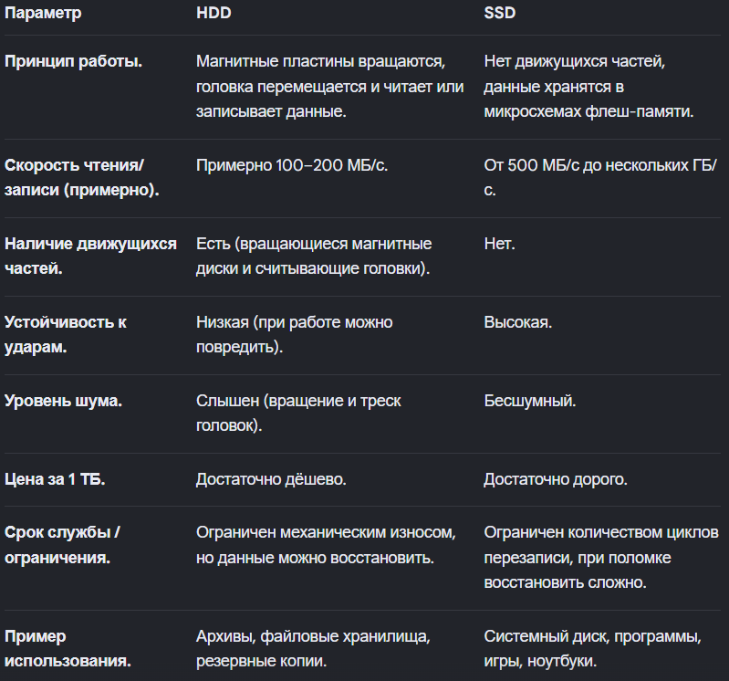

## Определение терминов:
1. DDR - Double Data Rate, удвоенная скорость передачи данных. Это тип оперативной памяти, который передаёт данные дважды за один такт: и на подъёме, и на спаде сигнала. Поэтому при той же частоте шины DDR работает вдвое быстрее обычной SDRAM.
2. DIMM — Dual In-line Memory Module, двойной рядный модуль памяти. Это тот самый «брусок» оперативной памяти, который вставляется в
материнскую плату. Название «dual in-line» означает, что контакты на двух сторонах платы независимы друг от друга, а не замкнуты, как у старых модулей SIMM .
3. Ранг (rank) — это логическая группа микросхем памяти на модуле, которая работает как единое целое. Один ранг выдает ровно 64 бита данных за раз. Если на планке две такие группы, это двухранговый модуль (2R). Ранг не связан с тем, с одной или двух сторон распаяны чипы — двухранговый модуль может быть односторонним.
4. CAS Latency (CL) — задержка в тактах между моментом, когда процессор запросил данные из памяти, и моментом, когда память их выдала. Чем меньше CL, тем быстрее память откликается на запрос. Но сравнивать CL можно только у памяти с одинаковой частотой.
5. Тайминги — это набор задержек, которые описывают, сколько тактов нужно памяти на разные операции: открыть строку, найти столбец, выдать данные. Обычно записываются как четыре числа, например 36-38-38-80. Первое — это CL, остальные — задержки на активацию строки, ее закрытие и время удержания строки открытой.
6. Двухканальный режим — это режим работы, при котором две планки памяти работают параллельно, удваивая пропускную способность шины данных (с 64 до 128 бит). Чтобы его включить, нужно вставить две одинаковые по объему и характеристикам планки в специальные слоты на материнской плате. Это даёт заметный прирост производительности в задачах, где важна скорость памяти.
